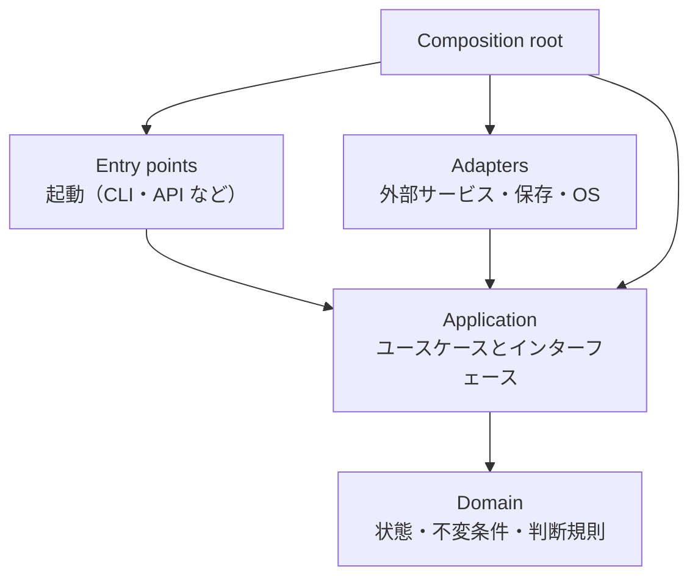

# 責務と依存方向

クリーンアーキテクチャを採用し、依存方向を外側から内側へ保つ。
この文書は、層の責務・依存方向・変更時の手順の定義元である。
クリーンアーキテクチャはテンプレートの既定であり、合意済みの判断ではない。
採否は機構設計（R1）で見直し、結果を ADR に記録する。別の構成を採る場合は、この文書を置き換える。
採用する言語・ライブラリ・物理構成は未定であり、決まったら [ADR](../adr/README.md) に記録し、この文書の「採用構成」節へ書く。

## 依存方向

各層がどの層を参照できるかを示す。
矢印はコードの依存方向であり、データの流れとは異なる。

実行時には、Application が自ら定義したインターフェースを介して外部機能を呼ぶ。
Domain は具体 SDK、ネットワーク、OS、プロセス、ファイル保存形式を知らない。

| 層 | 置くもの | 置かないもの |
| --- | --- | --- |
| Domain | 値、状態遷移、不変条件、純粋な判定規則 | CLI 引数、外部サービスの応答型、保存形式 |
| Application | ユースケースと、それが必要とするインターフェース | 特定の SDK や OS への直接依存 |
| Adapters | 外部製品・永続化・時刻・ID・ファイル・プロセスの実装 | 業務上の判定の独自コピー |
| Entry points / Composition root | 起動、設定の読み取り、依存の注入、起動時検証 | ドメイン規則の再実装 |

結合は Composition root へ集約する。
設定の読み取り・版の移行・外部エラーの翻訳は外側で行い、内側には検証済みの値と共通のエラー分類を渡す。

## 記録と状態の持ち方

- 正となる記録を一か所に定め、そこから生成できる報告に独立した状態を持たせない。
- 追加する状態・インターフェース・保存記録には、既存の仕組みでは満たせない責務・権限・復旧上の違いを求める。

簡素さと複雑度の評価の全般的な原則は、[設計の原則](principles.md) に従う。

## 場当たり的な修正を防ぐ手順

1. 失敗を再現し、どの不変条件または境界契約が破れたかを記録する。
2. 外部仕様への適応はアダプター、業務規則はドメイン、処理順はユースケースへ修正を帰属させる。
3. 同種の既存処理を調べ、類似の分岐やエラー処理を複製せずに共通の契約を修正する。
4. 元のケースに加え、同じ一般条件を持つケースと正常系で回帰を確認する。
5. 既存設計で表せない場合は責務を見直し、ADR で代替案・移行・影響を記録する。

一時的な互換対応が必要なら、対象版・理由・削除条件・回帰ケースを持たせ、外部境界に閉じ込める。

## 設計の検証

- 静的検査で、依存方向、循環参照、外部 SDK の型の内側への漏出を検出する。
- ドメインの検査は I/O なしで実行する。
- ユースケースの検査は fake 実装を使い、正常系と異常系の経路を確かめる。
- 各アダプターは、同じインターフェース仕様に対して実環境と fake の両方で確かめる。
- 意図的な違反例で検査が失敗することを確かめ、検査が機能していることを保証する。

依存方向を検査する具体的なツールは、採用構成と合わせて決める。

## 採用構成

未定。
言語・ランタイム・依存管理・テスト・依存方向の検査について、採用した版と理由を ADR に記録し、ここに一覧を置く。
